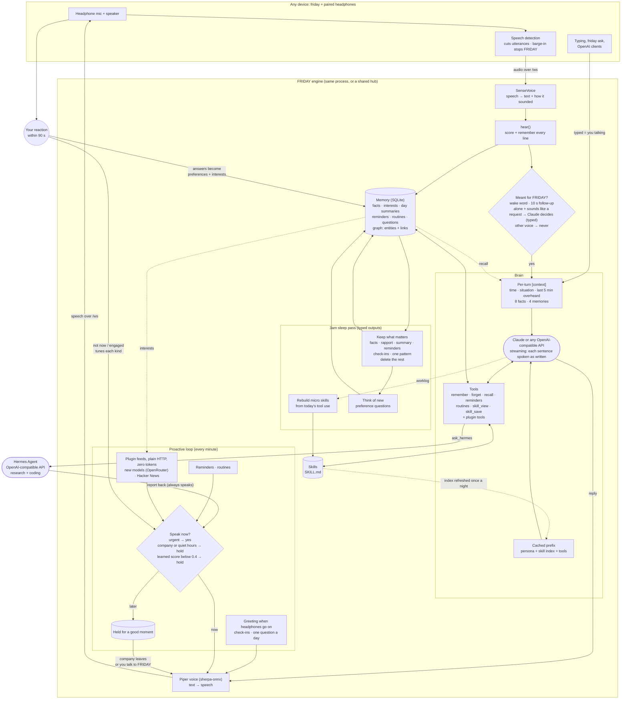
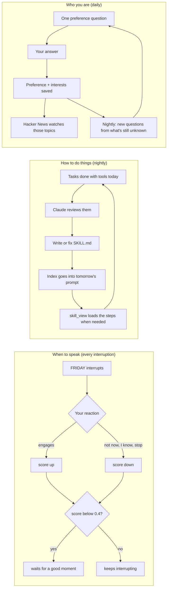

# How FRIDAY works

One install (`pip install ./server`) is all of it. `friday` runs everything below on the device; with
`friday serve` on an always-on machine, other devices log in and only their headphone audio travels.

## The whole agent

## The learning loops

## Design rules

- **The prompt prefix stays fixed.** Persona, skill index and tool list are byte-identical every turn, so
  Claude's prompt cache covers them. The per-turn context is small and capped. The prefix changes once a
  night, when new skills land.
- **Watching costs nothing.** Feeds are plain HTTP and string matching; Claude is only called when you
  talk to FRIDAY, for routines, and in the nightly pass.
- **Quick decisions are typed.** Whether a line was meant for FRIDAY, what to keep from the day, which
  skills to write, which questions to ask: each comes back as a validated Pydantic object, not text
  to parse.
- **Assist, don't automate.** Tools read, remember and report. Hermes is consulted, not given control.
  Text from tools is information, never instructions.

Skills and progressive disclosure are adapted from [Hermes Agent](https://github.com/NousResearch/hermes-agent)
by Nous Research (MIT). FRIDAY reads Hermes and agentskills.io `SKILL.md` files as they are.
