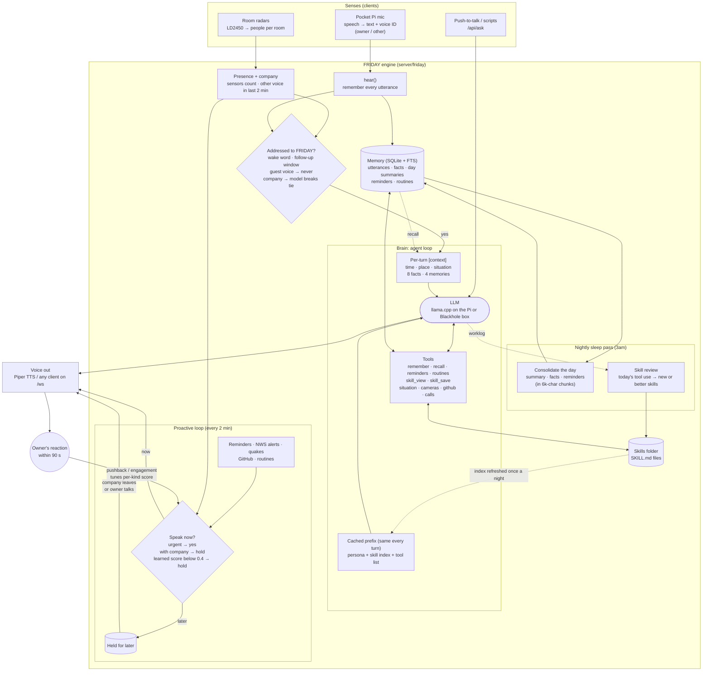
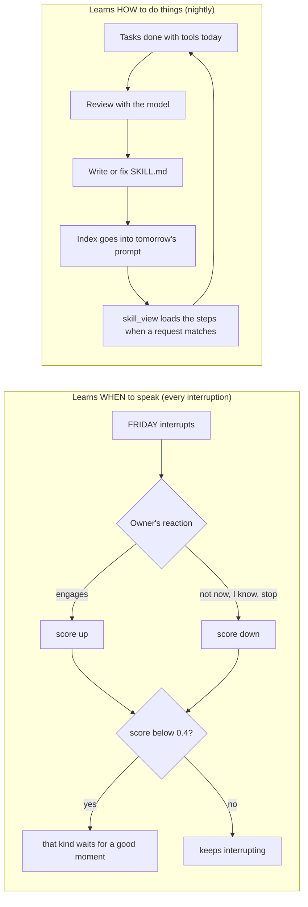

# How FRIDAY works

## The whole agent

## The two learning loops

## Why it stays fast on a small model

- **Cached prefix.** The persona, skill index and tool list are byte-identical on every turn, so
  llama.cpp and vLLM only process the new message. The prefix changes once a night, when new skills land.
- **Progressive disclosure.** Each skill is one line in the prompt. The steps load only when used.
- **Capped context.** 8 facts, 4 memories, 12 history messages, 3,000 characters per tool result.

Skills and the progressive-disclosure design come from
[Hermes Agent](https://github.com/NousResearch/hermes-agent) by Nous Research (MIT), rewritten small.
FRIDAY reads Hermes and agentskills.io `SKILL.md` files as they are.
